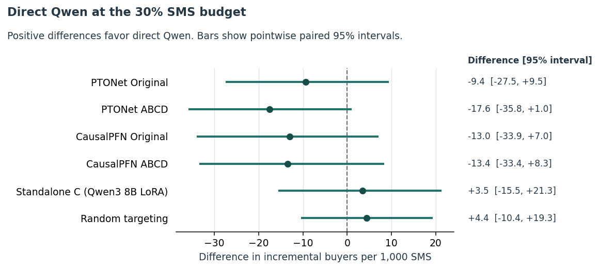

# Direct LLM uplift ranking on X5 RetailHero

Can a frozen Qwen3 8B rank customers for a promotional SMS by answering one question about each customer's expected change in purchase probability?

## Results on 40,008 customers

At 30% reach, direct Qwen’s top 12,002 customers yielded **37.61 incremental buyers per 1,000 SMS** (95% interval 19.92 to 55.63). Random targeting yielded **33.24**. The estimated advantage from using Qwen to choose customers was **4.37** (paired 95% interval −10.42 to +19.32). Both ABCD models scored higher at every budget. These results support keeping the direct prompt as a standalone benchmark.

| Targeting policy | Top 10% | Top 20% | Top 30% | Top 50% |
|---|---:|---:|---:|---:|
| **Direct Qwen3 8B, frozen** | **48.72** | **36.39** | **37.61** | **35.34** |
| Qwen3 8B, two forecasts with LoRA (standalone C) | 50.52 | 37.86 | 34.14 | 36.74 |
| PTONet Original | 69.99 | 50.00 | 46.96 | 45.47 |
| PTONet ABCD | 81.92 | 69.13 | 55.16 | 45.97 |
| CausalPFN Original | 47.01 | 45.74 | 50.61 | 37.28 |
| CausalPFN ABCD | 85.41 | 55.05 | 51.02 | 44.96 |
| Random targeting | 33.24 | 33.24 | 33.24 | 33.24 |

Scores are incremental buyers per 1,000 SMS sent. At 10% reach, Qwen had its largest estimated advantage over random, +15.48 (−13.88 to +45.28). Each of its four paired intervals against random includes zero. At 20% reach PTONet ABCD exceeded Qwen by 32.74 (+8.14 to +56.15), an exploratory pointwise comparison. Qwen’s normalized Qini was 0.00499 and its normalized AUUC was 0.00789. [Scores and intervals](direct-llm-scores.csv) · [Paired differences at every budget](direct-llm-contrasts.csv) · [Counts and purchases by arm and seed](direct-llm-seed-policies.csv)

**What Qwen actually answered.** Its most likely answer was **+2 percentage points for all 40,008 customers**. Using that answer alone ties everyone, so breaking ties at random yields 33.24 at every budget. The probabilities Qwen assigned to the nine answers produced 40,008 distinct weighted scores, ranging from −4.41 to +1.69 percentage points (median −0.83). The direct Qwen row above evaluates that probability-based ranking. [Score distribution and tie check](direct-llm-evaluation.json)

**Compute.** One prompt per customer took 59.63 minutes on one RTX 4080 SUPER, or 89.42 seconds per 1,000 customers, including prompt construction, tokenization and forward passes. This excludes checkpoint loading, verification and CPU evaluation. [Inference record](direct-llm-run.json)

## Connection to CURL

Xu et al. include a standalone **LLM** benchmark that prompts a language model to predict the conditional average treatment effect (CATE) from a textualized profile. Their main **CURL** method uses a causal host and LLM embeddings for selected customers. We adapted the standalone benchmark to the X5 randomized SMS campaign. The model, profile, prompt and numerical scale below are choices for X5. [CURL, Appendix A.2](https://arxiv.org/html/2607.26599v1#A1.SS2)

The original X5 study also recorded **standalone C**. It uses a Qwen3 8B LoRA adapter trained on observed purchases, prompts separately under SMS and no SMS, and ranks by the difference between those two forecasts. At 30% reach, the frozen direct prompt scored 3.47 higher than standalone C (paired 95% interval −15.51 to +21.28). [Earlier standalone evaluation](REPORT.md#standalone-feature-diagnostics)

## How one customer gets a score

The prompt provides 18 pre-SMS summaries and up to eight baskets in chronological order. It asks how sending the promotional SMS would change the probability of purchase, in percentage points. Each digit from 1 through 9 denotes one of −20, −10, −5, −2, 0, +2, +5, +10 or +20 percentage points. The score is the probability-weighted average of these values, using the model’s next-token logits restricted to the nine digits. Two customers whose most likely answer is the same can still receive different rankings.

The digit scale is a bounded way to elicit a ranking. The experiment measures the targeting value of that ranking using observed purchases in the randomized SMS and no-SMS arms. We fixed the prompt and ranking rule before inference. The 2,048-customer checkpoint is an outcome-independent subset of the full run. [Frozen prompt and registration](direct-llm-registration.json) · [Inference code](../../experiments/retailhero_abcd/direct_llm.py)

## How the comparison works

Each policy ranks the same 40,008 customers. At each budget, we take its highest-ranked customers, subtract the no-SMS purchase rate from the SMS purchase rate within that group, and multiply by 1,000. Random targeting uses the purchase-rate difference across the whole cohort as its expected value at each budget. A positive value for a policy describes the benefit of sending SMS to the customers it selects. Its gain over random targeting measures whether the ranking improves whom to contact.

The host comparisons use their original locked predictions. For PTONet, we evaluate each of three trained seeds and average their policy values. Intervals use 5,000 paired customer resamples stratified by SMS assignment. They describe evaluation-sample uncertainty conditional on the fitted policies. The follow-up reuses the X5 evaluation cohort and its primary 30% budget. All intervals are pointwise and the comparisons are exploratory. [Evaluation code](../../experiments/retailhero_abcd/direct_llm_evaluate.py)
